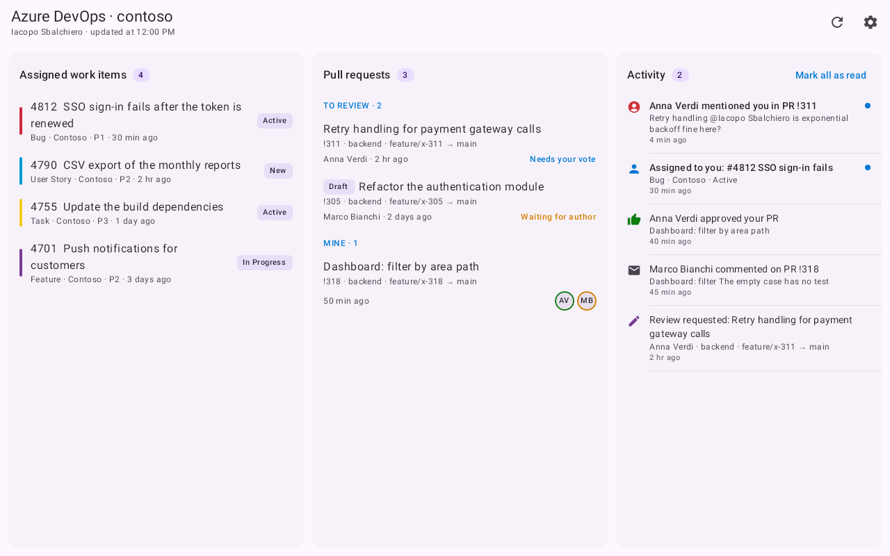
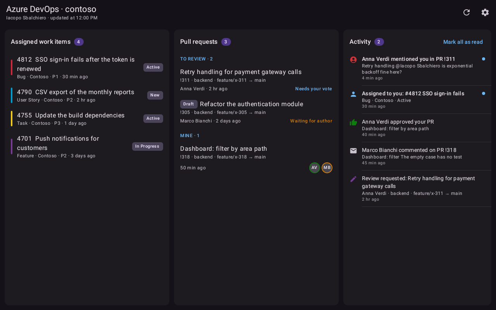
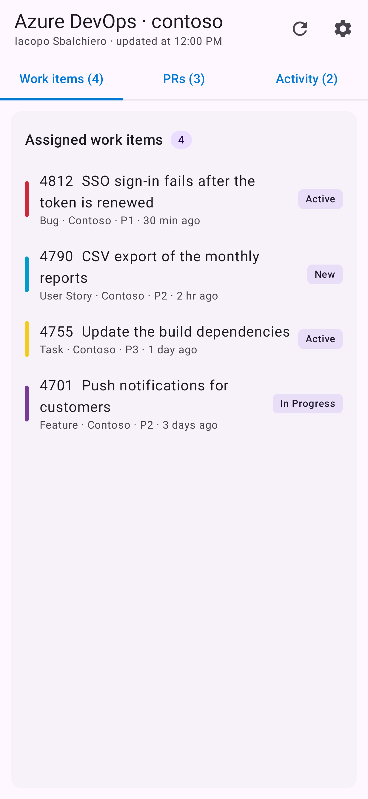

# ADO Dashboard

[](https://github.com/IacopoSb/ado-dashboard/actions/workflows/ci.yml)
[](https://github.com/IacopoSb/ado-dashboard/releases/latest)
[](LICENSE)

A native Android app for keeping an eye on Azure DevOps from a tablet.

It started because the Azure DevOps website is slow and awkward on touch devices: small
targets, hover menus, heavy pages that take a while to load on a tablet. ADO Dashboard puts
what you check most often on one screen that is quick to open and easy to tap: your work
items, the pull requests waiting for you and everything that happened since you last
looked. It also sends a notification when someone mentions you, assigns you something or
votes on your pull request.



## What it shows

- **Work items** assigned to you that are still open, sorted by priority, with the colours
  Azure Boards uses for each type.
- **Pull requests** in two groups: the ones you have to review, with your vote, and your
  own, with your reviewers' votes.
- **Activity**: new assignments, @mentions in work items and pull requests, comments on
  pull requests you follow, review requests and votes on your pull requests. Each one is
  also an Android notification; tap it to open the page on dev.azure.com.

Light and dark theme, Material You colours on Android 12+. Below 840 dp of width (a phone,
or a tablet held upright) the three columns become tabs.

<table>
  <tr>
    <td></td>
    <td></td>
  </tr>
</table>

## Install

1. Download the latest APK from [Releases](https://github.com/IacopoSb/ado-dashboard/releases/latest)
   and open it on the device (Android 8.0 or later). Android asks once to allow installing
   apps from your browser or file manager.
2. Open the app, enter your **organization** (the name in `dev.azure.com/<organization>`, or
   the full URL of a collection) and sign in, as described below.

The app checks the releases once a day and offers to install new versions itself; you can
also check by hand in *Settings*.

## Sign in

You need **one** of the two methods.

### Microsoft Entra ID (recommended)

Sign-in goes through MSAL, so it uses Microsoft Authenticator or Company Portal when they
are installed and respects MFA and conditional access. The token renews itself, also in
the background. Entra needs an app registration in the tenant that backs your Azure DevOps
organization; you (or your admin) do it once:

1. In the [Entra admin center](https://entra.microsoft.com), *App registrations* → *New
   registration*. Any name; *Accounts in this organizational directory only*; no redirect
   URI yet.
2. *Authentication* → *Add a platform* → *Android*. Enter the package name and signature
   hash that the app shows on its sign-in screen, next to the redirect URI (you can copy
   them from there).
3. *API permissions* → *Add a permission* → *Azure DevOps* → *Delegated* →
   `user_impersonation`. If users can't consent in your tenant, an admin has to *Grant
   admin consent*.
4. From *Overview*, copy the *Application (client) ID* and the *Directory (tenant) ID* into
   the app, then tap *Sign in with Microsoft*.

Leave the tenant ID empty to use the multi-tenant endpoint; the registration must then
accept *Accounts in any organizational directory*.

### Personal access token

Under *Other options*, for organizations without Entra or when you can't register an app.
The token needs **Read** on *Work Items*, *Code* and *Project and Team*. It is encrypted
with a key from the Android Keystore and never leaves the device.

## How it works

Azure DevOps can't push to a third-party app without a server in between, and this app has
no server: it polls the REST APIs directly from the device.

- While the dashboard is on screen: every 60 seconds (configurable).
- In the background: every 15 minutes, the minimum Android allows for periodic work.

The first sync is a baseline, so you aren't flooded with what already existed. Every event
has a stable key and the local database drops the ones it has seen, so no notification
arrives twice. Notification rules follow Azure DevOps: every comment on your own pull
requests; on the ones you review, only threads you took part in and mentions.

## Privacy

Everything stays on the device: there is no backend, no analytics and no third-party
service. The app talks only to `dev.azure.com` (or your collection URL), to Microsoft's
sign-in endpoints and, for the update check, to the GitHub API.

## Languages

The app follows the device language: English and Italian. Its texts are Android string
resources (`app/src/main/res/values*/strings.xml`), so adding a language means adding one
file; translations are welcome.

## Build from source

You need JDK 17+ and the Android SDK 35 (`sdk.dir` in `local.properties`).

```bash
./gradlew assembleDebug        # APK in app/build/outputs/apk/debug
./gradlew testDebugUnitTest    # unit tests and Roborazzi screenshots in app/build/outputs/roborazzi
```

| Package | Contents |
| --- | --- |
| `api` | Azure DevOps REST client (OkHttp, kotlinx.serialization) |
| `auth` | Entra sign-in with MSAL |
| `data` | settings (DataStore), events (Room), PAT encryption |
| `sync` | reading data, computing events, notifications, background worker |
| `update` | update check and install from GitHub releases |
| `ui` | Jetpack Compose screens |

## Contributing

Issues and pull requests are welcome. Commits follow
[Conventional Commits](https://www.conventionalcommits.org/): the release notes are built
from `feat`, `fix` and `perf` commits.

## License

[MIT](LICENSE) © Iacopo Sbalchiero
